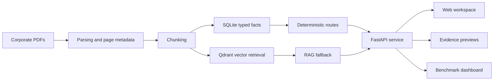

# italianRAG — Evidence-First Document Intelligence

> A public, recruiter-readable engineering case study. The implementation repository is private because the project was developed during an internship; this page documents the problem, architecture, evaluation approach, technical decisions, and limitations without publishing private material.

## Overview

`italianRAG` is a local document-intelligence workspace for Italian corporate documents such as financial statements, company statutes, and Chamber of Commerce registry reports.

The project was developed during a three-month AI & Data internship at InfoCamere. Its goal was not to build a generic chatbot, but to create an inspectable prototype that can turn heterogeneous PDFs into:

- structured, typed facts;
- grounded answers with source evidence;
- comparisons across multiple documents;
- reproducible benchmark results.

The central design principle is simple: **verifiable fields should not be treated like free-form generated prose**.

## The problem

Corporate PDFs are difficult to automate reliably because they vary in layout, terminology, document type, and text quality. Some are digitally generated, while others are scanned or contain compact tables and registry-style formatting.

A useful system therefore has to answer several questions:

1. Can a requested value be extracted deterministically?
2. Which document and page support the result?
3. Is the field present, missing, uncertain, or outside the analysed scope?
4. When deterministic extraction is not suitable, can retrieval provide grounded context?
5. Can changes be measured without relying only on manual demos?

## Architecture

### Main components

- **FastAPI** for the service and workspace endpoints.
- **Pydantic v2** contracts for requests, answers, citations, traces, and structured profiles.
- **SQLite** for normalized facts and explicit field states.
- **Qdrant** for vector retrieval over document chunks and metadata.
- **Configurable embeddings and reranking** for open-ended retrieval.
- **Deterministic routing** for fields where repeatability and auditability matter.
- **Opt-in OCR/VLM rescue** for image-only or difficult pages, disabled by default.
- **Benchmark tooling and dashboards** for regression testing.

## Hybrid routing: deterministic first, RAG when appropriate

The system separates two categories of work.

### Typed deterministic routes

Used for fields such as:

- registered office and company identity;
- share capital;
- governance information;
- financial values and multi-year series;
- structured registry-report fields;
- statute–registry reconciliation.

These routes return structured values, field status, evidence, and processing trace.

### Retrieval / RAG routes

Used for broader questions that do not map safely to a predefined extractor. Retrieval uses document and company metadata, then returns source-linked context rather than presenting unsupported generation as a verified fact.

This division reduces a common failure mode in document AI: a fluent response being mistaken for a validated data point.

## Cross-document analysis

The project also supports analysis across documents belonging to the same company, including:

- multi-year financial comparisons;
- statute versus registry-report consistency checks;
- timelines across multiple registry reports;
- explicit missing, uncertain, and not-applicable states.

The output is intended to make disagreement and incomplete evidence visible rather than hiding them behind a single answer string.

## Evaluation

A canonical structured benchmark contains **116 cases** covering supported deterministic routes.

Recorded result:

| Metric | Result |
|---|---:|
| Answer-correct | 116/116 |
| Citation-supported | 116/116 |
| Gold-verified | 116/116 |

### What that result means

It shows that the defined 116-case deterministic benchmark was reproduced successfully for the tested dataset and routes.

### What it does not mean

It is **not** a claim of universal 100% accuracy for arbitrary PDFs, open-ended RAG questions, unseen companies, OCR, or production traffic. The benchmark is deliberately scoped and documented so that the number remains meaningful.

## Engineering decisions and trade-offs

### Why keep deterministic extraction alongside RAG?

Structured corporate fields benefit from repeatable parsing, typed contracts, and explicit missing-value semantics. RAG remains useful for exploratory questions, but it should not silently replace verifiable extraction.

### Why retain `pypdf` as the default parser?

Parser alternatives were evaluated, including an OCR/VLM rescue path for scanned documents. The production default remained the simpler parser because it was fast and sufficient for searchable PDFs; heavier rescue paths are opt-in and targeted at actual extraction gaps.

### Why make evidence a first-class object?

Answers include page references, evidence excerpts, route information, and trace metadata. This helps with debugging, review, benchmark adjudication, and user trust.

### Why use a deterministic benchmark provider?

The canonical benchmark isolates routing, extraction, and citation behaviour from remote-model variability. Generative providers can then be compared separately without weakening the regression baseline.

## What I personally worked on

- FastAPI API and local workspace design.
- Typed extraction and document-specific routing.
- SQLite fact modelling and field-state semantics.
- Qdrant retrieval, metadata filters, and reranking experiments.
- Cross-document financial and registry analysis.
- Benchmark datasets, adjudication tools, regression tests, and dashboards.
- Parser comparison and opt-in OCR/VLM recovery experiments.
- Technical documentation, diagrams, and a structured project knowledge base.

## Technologies

`Python` · `FastAPI` · `Pydantic` · `SQLite` · `Qdrant` · `RAG` · `embeddings` · `reranking` · `pytest` · `OCR/VLM evaluation` · `HTML/CSS/JavaScript`

## Current limitations

- The implementation repository is private.
- Scanned and highly irregular PDFs require explicitly enabled recovery paths.
- Deterministic coverage is document- and field-specific.
- Benchmark results apply only to the documented dataset and scope.
- Human review remains necessary when evidence is weak, conflicting, or incomplete.

## What this project demonstrates

- Designing AI systems around traceability instead of presentation alone.
- Combining deterministic software with probabilistic retrieval.
- Treating evaluation artifacts as part of the product.
- Building typed APIs and data contracts for document workflows.
- Communicating scope and limitations honestly around strong metrics.

---

**Author:** [Simone Perini](https://github.com/tzii)  
**Role focus:** AI software engineering · Python backends · document intelligence
