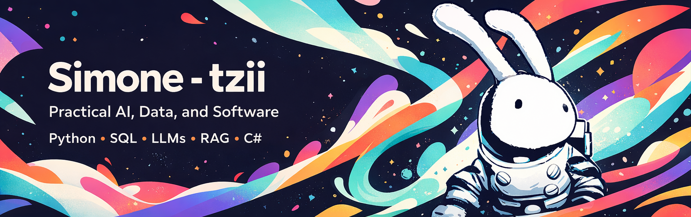

  

# Simone Perini

**Agentic AI / Software Engineer** focused on document intelligence, RAG, Python backends, and dependable AI systems.

I build software that turns messy real-world inputs into structured, testable workflows. I completed a **Higher Technical Diploma in AI & Data (EQF Level 5)** with a final grade of **107/110**. My work spans LLM/RAG systems, agentic workflows with LangChain/LangGraph, computer vision and reinforcement learning, plus production-minded software engineering.

## Selected work

- **[italianRAG — engineering case study](./ITALIANRAG_CASE_STUDY.md)**  
  Evidence-first document intelligence for Italian corporate PDFs, combining typed extraction, Qdrant retrieval, cross-document analysis, and reproducible evaluation. Built during my AI & Data internship at InfoCamere.

- **[Pefforza 4](https://github.com/tzii/Pefforza_4)**  
  Connect Four AI system combining physical-board computer vision, PPO reinforcement learning, bitboard alpha-beta search, an exact solver, automated evaluation, and CI.

- **[KeeFetch](https://github.com/tzii/KeeFetch)**  
  A .NET plugin for KeePass with concurrent favicon retrieval, ranked provider selection, privacy controls, automated tests, and packaged releases.

- **[ThystTV](https://github.com/tzii/ThystTV)**  
  Android/Kotlin media-client work focused on player UX, floating chat, local statistics, release engineering, and upstream maintenance.

- **[ScrapingStore](https://github.com/tzii/ScrapingStore)**  
  Python data pipeline for scraping, cleaning, storing, and analysing web data.

## Core stack

`Python` · `FastAPI` · `Pydantic` · `SQL` · `Qdrant` · `RAG` · `LangChain` · `LangGraph` · `LLM/VLM evaluation` · `pytest` · `Docker` · `GitHub Actions` · `C# / .NET` · `Kotlin / Android`
